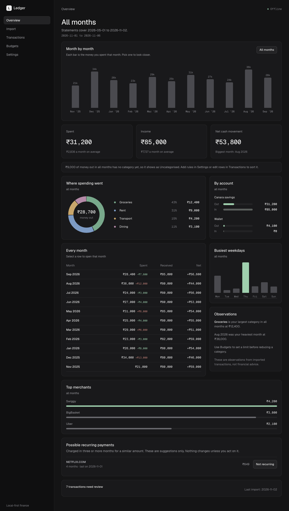

# Ledger

Ledger is a private personal-finance app for your Mac. Import your bank statements (CSV, Excel or PDF), and Ledger shows where your money went, month by month, without sending anything anywhere. Everything stays on your computer.



## Install (one command)

Open **Terminal** (press `Cmd + Space`, type `Terminal`, press Enter), paste this, and press Enter:

```sh
curl -fsSL https://raw.githubusercontent.com/sanjayrohith/ledger/main/install.sh | bash
```

That is all. The installer checks your Mac, installs anything that is missing (Xcode Command Line Tools, Rust, Node.js), builds Ledger on your machine, puts **Ledger.app** in your Applications folder, and opens it. The first install takes about 5 to 10 minutes because it compiles the app. After that, open Ledger like any other app.

- **Needs:** a Mac with Apple Silicon (M1 or newer) and an internet connection during install only.
- **Node.js:** if the installer says Node.js is missing, install the LTS version from [nodejs.org](https://nodejs.org), open a new Terminal window, and run the command again. If you use Homebrew, the installer does this for you.
- **Update to the latest version:** run the same command again. Your transactions are kept, because only the app is replaced.
- **Prefer to read the script first?** It is [`install.sh`](install.sh), about 100 lines, and it only downloads this repository and builds it.

If you already cloned the repository, run `./install.sh` from inside it, or `npm run install:mac`.

### First launch

The app is built on your own Mac and is not signed with a paid Apple Developer ID. The installer clears the download flag so it opens normally. If macOS still blocks it, right-click **Ledger.app** in Applications, choose **Open**, then confirm. Or allow it in System Settings, Privacy & Security.

## Quick start

1. Open Ledger and go to **Import**. Create an account, such as "Canara savings".
2. Choose your statement: CSV, XLSX or PDF. For a password-protected PDF, enter the password when asked. It is used once and never saved.
3. Check the preview, then press **Import**. The preview shows which rows are new and which Ledger already has, so uploading overlapping weekly statements is safe.
4. Open **Overview** to see charts by month, category, account and weekday. Click any month in the timeline to look closer.
5. Use **Transactions** to fix categories, **Settings** for rules, backups and exports, and **Budgets** to set monthly limits.

Full walkthrough: [`docs/USER_GUIDE.md`](docs/USER_GUIDE.md).

## What Ledger does

- **Imports** CSV, XLSX and Canara Bank PDF statements. Weekly overlapping uploads add only new rows. You can delete an import, or delete everything in a date range, and upload again.
- **PDF statements** are read on your Mac and checked against the statement's own opening and closing balances. If the numbers do not add up, Ledger refuses to import them.
- **Overview** shows spending month by month, an all-months view, where money went by category, which account it left from, the busiest weekdays, top merchants, and possible recurring payments.
- **Transactions** can be searched and filtered by date, account, direction, category and review status.
- **Rules and budgets** classify merchants automatically and track monthly limits.
- **Backups** can be plain or passphrase-encrypted, and you can export your transactions to CSV.

It does not use a bank login, cloud sync, telemetry, or remote assets. Ledger makes no network calls at runtime.

## Where your data lives

Ledger creates its SQLite database on first launch in `~/Library/Application Support/com.local.ledger/`. A new install contains no accounts and no financial records. The file is readable only by your macOS user. It is not encrypted by the app, so keep FileVault on. See [`docs/PERFORMANCE.md`](docs/PERFORMANCE.md) for measured speed on 50,000 transactions.

## Troubleshooting

| Problem | Fix |
| --- | --- |
| `command not found: curl` or `git` | Run `xcode-select --install`, then run the install command again. |
| "Node.js is missing" | Install the LTS version from [nodejs.org](https://nodejs.org), open a new Terminal window, run the command again. |
| macOS says the app cannot be opened | Right-click **Ledger.app**, choose **Open**, confirm. |
| A PDF says the balances do not match | The statement layout may differ from what Ledger knows. The message names the rows. It contains no statement text, so it is safe to share in an issue. |
| Overview looks empty | Import a statement first. Imported rows with no category show as "Uncategorised" until you add rules. |

## Uninstall

Quit Ledger, drag **Ledger.app** from Applications to the Trash, and delete `~/.ledger-src` (the downloaded source). To also erase your data, delete `~/Library/Application Support/com.local.ledger`. That is irreversible unless you made a backup.

## Development

```sh
npm install
npm run tauri dev
```

`tauri dev` uses a loopback Vite server only while developing. The production application contains static frontend assets and does not need a server or browser.

## Checks

```sh
npm run typecheck
npm run lint
npm test
cd src-tauri && cargo fmt --check && cargo clippy -- -D warnings && cargo test && cargo build
npm run tauri build
```

The macOS `.app` and `.dmg` build artifacts are produced under `src-tauri/target/release/bundle/`. The build is unsigned and not notarised, because that needs a paid Apple Developer ID. On first open macOS may refuse it. Right-click `Ledger.app`, choose Open, then confirm, or allow it in System Settings, Privacy & Security. Copy it to Applications first if you want to keep it.

## Sharing a statement layout without sharing data

To help build PDF import without sending a real statement anywhere, run this in Terminal (it works offline):

```sh
cd src-tauri
cargo run --release --example pdf_layout -- "/path/to/statement.pdf"
```

It asks for the PDF password if there is one (typing is hidden), prints a layout where every digit is `9` and every letter is `X` or `x` (except generic words such as Date and Balance), checks that nothing else got through, and saves `src-tauri/pdf-layout-masked.txt`. Read that file before sharing it.

## Privacy

Ledger makes no network calls at runtime and includes no telemetry, analytics, remote assets, account login, or financial records in the shell. The SQLite database is stored in macOS Application Support with owner-only permissions where supported. It is not application-level encrypted; use FileVault and a secured macOS account.

## Backup, restore, export, and deletion

- **Encrypted backup** (Settings) writes a passphrase-protected `.age` file using the maintained `age` library with scrypt. There is no recovery if the passphrase is lost. Plain `.sqlite3` backups are not encrypted.
- In **Settings**, use **Create backup** to write a self-contained local `.sqlite3` backup. Keep it somewhere protected.
- **Restore backup** validates SQLite integrity and Ledger migration metadata before it replaces local data.
- **Export transactions CSV** creates a portable, local CSV of the imported transaction records.
- **Clear personal financial data** permanently removes accounts, imports, transactions, rules, merchants, and budgets only after typing `DELETE`. Built-in categories remain. Create a backup first if you may need recovery.

To remove Ledger fully, quit the app, move the app bundle to Trash, and delete its `com.local.ledger` folder from your macOS Application Support directory. This is irreversible unless you retained a backup.
